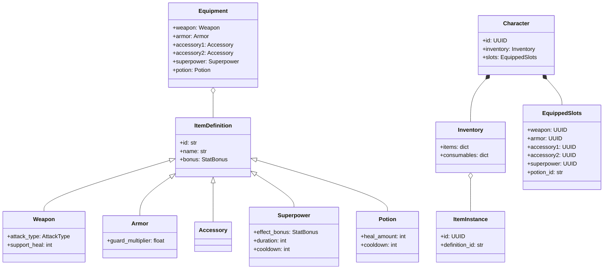
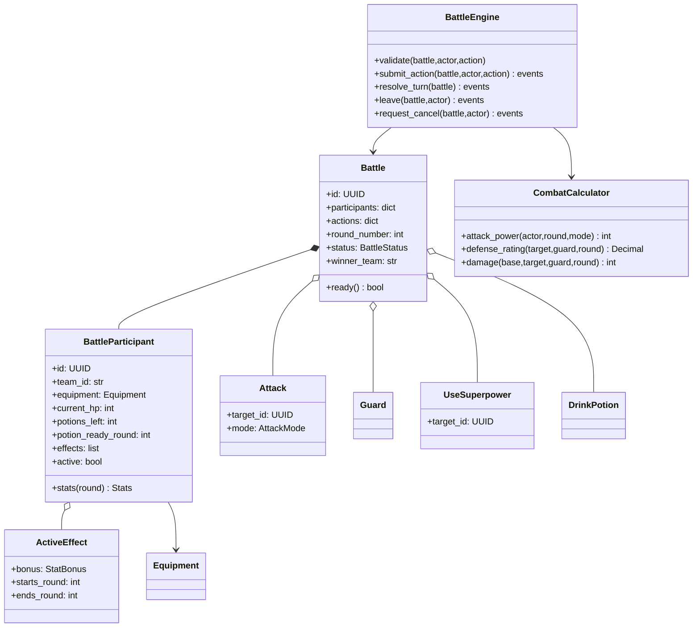
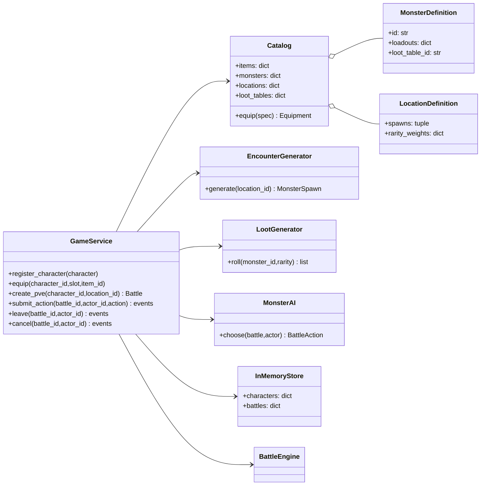
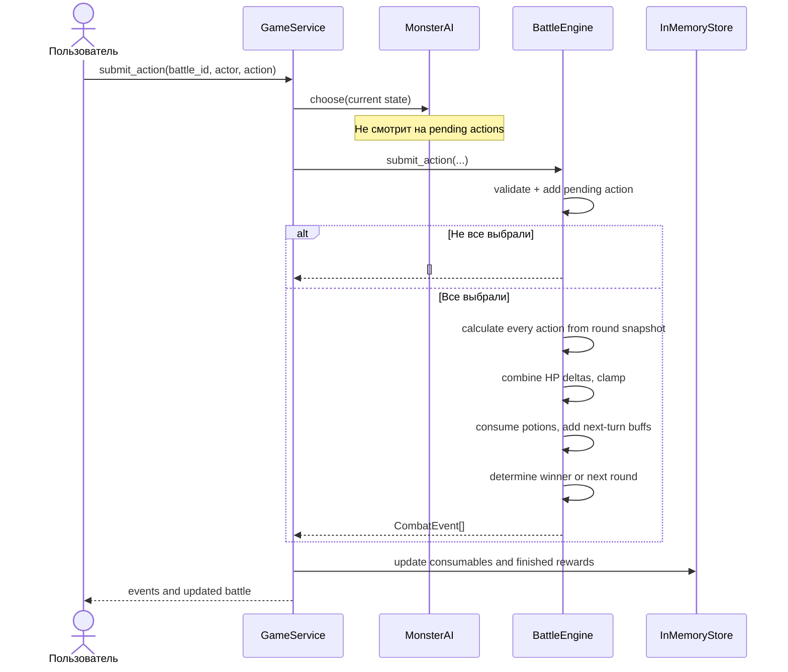

# Архитектура игрового ядра

## Принципы

- **Composition over inheritance**: персонаж, моб и босс создают одинаковый `BattleParticipant` с комплектом `Equipment`. Нет отдельных боевых подклассов `Warrior`, `Mage`, `Slime`.
- **Single Responsibility**: `models.py` описывает состояния, `engine.py` проверяет и рассчитывает боевые переходы, `world.py` содержит генераторы встреч и добычи, `service.py` координирует сценарии.
- **Open/Closed**: новые мобы, оружие, локации и таблицы добычи добавляются определениями в каталог. Новый тип принципиально другого эффекта потребует отдельного обработчика.
- **Dependency direction**: `engine` зависит от моделей, но не от консоли/Telegram/хранилища. Внешний код вызывает `GameService`.
- **Domain snapshots**: сражение содержит собственный набор объектов экипировки, поэтому замена снаряжения персонажа не влияет на идущий ход; во время боя смена экипировки запрещена.

## Предметы и персонажи

## Бой и правила

**Все действия коммитятся одновременно:** по начальным данным хода высчитываются атаки/хил, фиксируются дельты HP, затем они применяются *один раз*. Эффект суперсилы начинает работать на следующий ход. Команды выигрывают, если после конца хода у другой команды не осталось живых активных бойцов. При гибели обеих команд одновременно — ничья.

## Мир и application

`GameService` используется и из `main.py`, и будущим Telegram-адаптером. `InMemoryStore` — только первый вариант хранилища, его следует заменить реализацией Repository + Unit of Work при интеграции настоящего сервера. Для начала не стоит создавать абстрактные слои там, где нет второй реализации.

## Переход одного хода

В реализации `_fill_ai_actions` обычно вызывается при создании боя и после разрешения предыдущего хода, так что в обычном однопользовательском PvE ИИ уже сделал скрытый выбор до показа очередного меню.

## Следующее расширение

1. Выделить порт `BattleRepository` и транзакционный `UnitOfWork` для безопасных конкурентных запросов.
2. Описать эффекты декларативными спецификациями и добавить `EffectResolver` с явно заданными стадиями хода.
3. Расширить `UseSuperpower` с одного дружественного таргета на различные ограничения целей.
4. Загрузить каталог из YAML с валидацией и ID-ссылками.
5. Добавить use-cases `create_pvp`, `create_raid`, подключение новых игроков, отображение команд, авторизацию действий и сохранение состояния.
