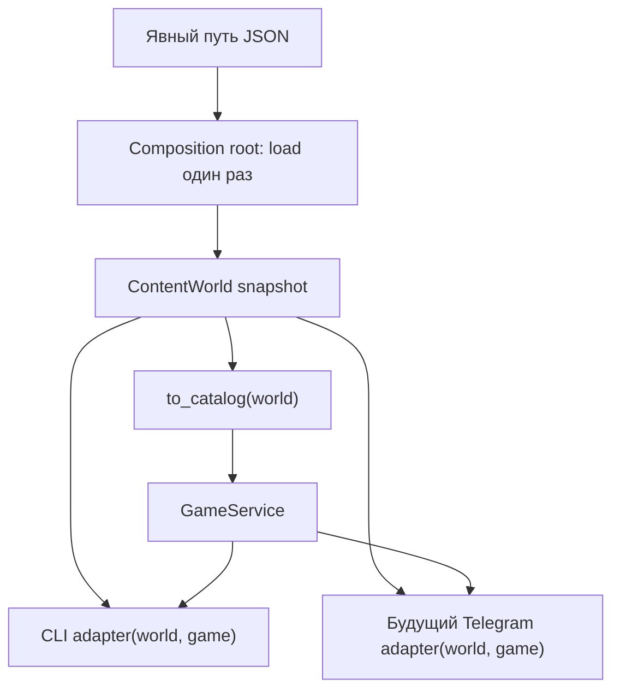

# Отдельный пакет игрового контента rpg_content

Дата: 2026-11-02. Статус: спецификация для последующей реализации.

## Цель и границы

Дать внешней нейросети короткое задание на предметы, монстров, локации,
NPC/персонажей и сюжетные заготовки, получить небольшой JSON и проверить его
перед добавлением в мир. Данные мира хранятся отдельно от Python-кода.

`rpg_content` — независимый импортируемый пакет в собственной distribution
`rpg-content` версии `0.1.0`, Python >= 3.10, со стандартной библиотекой в runtime.
Он поставляется из того же репозитория, но собирается и устанавливается отдельно
от `telegram-rpg-core`. Публикация на PyPI не входит в задачу. Пакет не зависит
от `core`, `main`, Telegram, нейросетевых API или базы данных и не импортирует их.
Его модели описывают контент, а не состояние игрока или боя.
ID транспорта (Telegram user/chat/message ID и аналогичные CLI-привязки)
не входят в схему контента; их хранение относится к adapter/store приложения.

В v1 нет исполнения квестов, условий, наград сюжета, диалоговых ветвлений,
сохранений, генерации через API, наследования записей и шаблонизатора.
NPC, реплики и сюжет — проверяемые данные для будущего потребителя.

## Размещение и публичная граница

```text
packages/rpg_content/
  pyproject.toml   # distribution rpg-content 0.1.0, собственная сборка
  src/rpg_content/
    __init__.py    # публичные функции, модели и ошибки
    __main__.py    # тонкий python -m rpg_content adapter
    models.py      # immutable definitions, ContentRef, ContentDocument, ContentWorld
    validation.py  # единые правила полей и проверка графа
    parser.py      # JSON text -> detached ContentDocument
    io.py          # чтение и атомарная запись
    merge.py
    context.py
    resources/
      common.md
      items.md     # аналогично для остальных пяти секций
      examples/    # по одному минимальному JSON-примеру на секцию
core/content_adapter.py # to_catalog(world) -> Catalog
content/demo.json       # внешний демонстрационный мир
```

Wheel `rpg-content` содержит только `rpg_content`, его ресурсы и служебные
метаданные distribution. Ресурсы читаются через `importlib.resources`.
Потребитель устанавливает локальный исходник командой
`python -m pip install ./packages/rpg_content` либо устанавливает собранный wheel.
Мир передаётся явным путём: пакет не ищет его в текущем каталоге и не узнаёт
автоматически, какой мир использует запущенная игра. `content/demo.json`
остаётся внешним файлом и не входит в wheel пакета.

Корневая distribution `telegram-rpg-core` исправляет `packages = ["telegram_rpg"]`
на `packages = ["core"]` и объявляет зависимость `rpg-content>=0.1,<0.2`.
Локальная установка обоих проектов: `python -m pip install ./packages/rpg_content .`.
Wheel игры содержит `core`, но не вторую копию `rpg_content`.

## Публичные модели и операции

Все модели, ошибки и перечисленные функции экспортируются из `rpg_content`;
потребитель не обращается к внутренним модулям. `Definition` означает union
`ItemDefinition | MonsterDefinition | LocationDefinition | LootTableDefinition |
NpcDefinition | StorySeedDefinition`.

`ContentRef(section, id)` — типизированный immutable value object, где section
ограничена шестью секциями. `ContentRef.parse(text: str) -> ContentRef` проверяет
синтаксис `секция:id`; существование цели проверяется на уровне мира.
Ссылки внутри публичных definitions представлены ContentRef, а не сырыми
JSON-строками; nullable-поля сохраняют None по контракту. Например,
`world.resolve(npc.location)` работает после проверки `npc.location is not None`.
`ContentDocument` — структурно валидный detached документ: типы, локальные
диапазоны, уникальность ID внутри секций и синтаксис ссылок уже проверены,
но цели ссылок могут находиться в другом документе.

`ContentWorld` — целостный глубоко неизменяемый snapshot. Его read-only свойства:

| Свойство | Тип |
| --- | --- |
| `schema_version` | `int` (в v1 только 1) |
| `canon` | `str` |
| `items` | `Mapping[str, ItemDefinition]` |
| `monsters` | `Mapping[str, MonsterDefinition]` |
| `locations` | `Mapping[str, LocationDefinition]` |
| `loot_tables` | `Mapping[str, LootTableDefinition]` |
| `npcs` | `Mapping[str, NpcDefinition]` |
| `story_seeds` | `Mapping[str, StorySeedDefinition]` |

Mapping сохраняют порядок документа/объединения. `world.locations.values()` и
`world.npcs.values()` перечисляют все записи, включая narrative-локации и NPC
без location. Генераторный scope контекста не ограничивает публичное чтение мира.
`world.locations[id]` и аналогичный доступ к остальным mapping возвращают
типизированное определение; отсутствующий ключ вызывает стандартный `KeyError`.

`world.resolve(ref: ContentRef) -> Definition` разрешает ссылку. Отсутствующая
цель вызывает доменную `UnknownContentReference` с section/id.
`world.npcs_at(location_id: str) -> tuple[NpcDefinition, ...]` возвращает NPC
в порядке мира: для известной локации без NPC — `()`, для неизвестной —
`UnknownContentReference` на `locations:location_id`. Эти convenience methods
намеренно дают доменную диагностику, тогда как mapping сохраняют контракт Python.

Definitions и вложенные value objects проверяют локальные invariants при каждом
публичном конструировании. Все коллекции, в том числе loadouts, бонусы, refs,
реплики и вложенные записи, защищены рекурсивно: tuple и read-only mapping
над собственными defensive copies. Наружу не возвращаются изменяемые dict
или ссылки на изменяемый вход. `frozen=True` сам по себе этого не обеспечивает.
Для `ContentDocument` действуют те же правила владения данными.

Выбран простой контракт: публичный конструктор `ContentWorld` всегда проверяет
полный граф, соответствие ключей mapping ID определений и все межсекционные
ограничения, независимо от того, создан ли мир через parser или вручную.
Публичного unchecked/validated bypass конструктора нет. Поэтому нельзя получить
мир с висячей ссылкой прямым вызовом frozen dataclass.

```text
parse(text: str, source: str = "<memory>") -> ContentDocument
load(path: str | Path) -> ContentWorld
validate(document: ContentDocument, base: ContentWorld | None = None) -> ContentWorld
merge(documents: Iterable[ContentDocument]) -> ContentWorld
build_context(world: ContentWorld, *, section: str, task: str, refs: tuple[ContentRef, ...] = (), index_refs: tuple[ContentRef, ...] = (), max_chars: int) -> str
```

`parse` выполняет JSON- и структурную проверку без разрешения внешних ссылок.
`load` читает файл, затем выполняет parse и полную validate.
`validate(document)` создаёт замкнутый мир; с `base` создаёт новый мир из базы
и дополнения по add-only правилам merge, не меняя базу. `merge` проверяет полный
объединённый граф после структурной проверки каждого документа; пустой iterable
даёт пустой мир schema_version 1 с пустым canon. Ни одна операция не изменяет вход.

Ошибки данных принадлежат публичной иерархии `ContentError`, содержат source,
JSON-путь, код и короткое объяснение; `UnknownContentReference` — её подтип.
Для программного создания source равен `<memory>`. Ошибки I/O также переводятся
в публичную ошибку с source и кодом. Библиотека не печатает, не логирует и не
завершает процесс и не обращается к сети. `parse`, `validate` и `merge` — чистые
функции; `load` читает внешний файл мира. `build_context` самодостаточен для
внешнего Python-клиента: сам читает только собственные bundled rule/example
ресурсы через `importlib.resources`. Это ограниченный I/O, поэтому функция
не называется чистой. CLI вызывает тот же публичный API и не собирает правила
сам; он отвечает за вывод, диагностику размера, exit codes и запись output.

В `build_context` section должна быть одной из шести секций, task — непустой
строкой после trim, max_chars — положительным int, причём bool отклоняется.
Пустые tuple refs/index_refs соответствуют CLI `--no-refs`/`--no-index`.
При превышении бюджета возбуждается публичная `ContextBudgetExceeded`, подтип
`ContentError`, с `actual_chars` и `max_chars`; частичный результат не возвращается.

## Объектная модель и ответственность

Небольшие immutable модели компонуются: value objects владеют локальными
invariants, `ContentWorld` предоставляет чтение и разрешение связей и гарантирует
целостность графа. Parser отвечает за перевод JSON, I/O adapter — за файлы,
CLI adapter — за аргументы и диагностику. Правила полей предметов по kind
имеют единый источник в пакете: конструкторы и validator используют общий контракт,
а инструкции и примеры проверяются на соответствие ему тестами. Раздельные копии
правил в моделях, validator и prompt не поддерживаются.

Новый NPC — новая запись данных, без отдельного подкласса. Общая базовая Entity
с CRUD или Telegram-методами не вводится. Repository, EventBus и DI-container
не требуются для этих сценариев. Критерий дизайна — ясные обязанности,
проверяемые invariants и независимость потребителей, без обещания формального
полного SOLID или «идеального ООП».

## JSON-контракт v1

UTF-8, один объект: обязательный `schema_version: 1`; необязательные `canon`
(строка, по умолчанию `""`) и шесть массивов `items`, `monsters`, `locations`,
`loot_tables`, `npcs`, `story_seeds` (по умолчанию `[]`). Других полей нет.
Неподдерживаемая версия отклоняется, автоматической миграции нет.

Во всех записях обязательны `id` и `name`: ID соответствует
`[a-z][a-z0-9]*(?:_[a-z0-9]+)*`, имя — непустая строка после trim.
ID уникален внутри секции; одинаковый ID в разных секциях допустим.
Общее необязательное поле `description` — строка, по умолчанию `""`.
Ссылка — строка `секция:id`, например `items:steel_sword`.
Префикс проверяется по полю, затем проверяется существование цели.
Ни имена, ни похожие ID не используются для автоматического разрешения ссылок.

Ниже перечислены все дополнительные поля; `?` означает необязательное поле.
Все текстовые поля — строки; списки текста не содержат пустых строк.

| Секция | Поля и смысл |
| --- | --- |
| `items` | `kind`: `weapon/armor/accessory/superpower/potion`; `rarity?`: одна из шести редкостей, default `common`; `bonus?`: бонусы характеристик. Поля конкретного kind перечислены ниже. |
| `monsters` | `loadouts`: объект ровно с шестью ключами редкостей; `loot_table`: ссылка на `loot_tables`; `is_boss?`: bool, default false. |
| `locations` | `mode`: `encounter/narrative`; `spawns?`: массив `{monster, weight}`, где monster ссылается на `monsters`; `rarity_weights?`: объект весов редкостей. |
| `loot_tables` | `entries`: массив `{item, chance, min_quantity?, max_quantity?}`; item ссылается на `items`, обе величины количества default 1. Пустой массив означает отсутствие добычи. |
| `npcs` | `role`: непустой текст; `location?`: ссылка на `locations` или null, default null; `lines?`: список реплик, default `[]`; `refs?`: список типизированных ссылок, default `[]`. |
| `story_seeds` | `premise`: непустой текст; `hooks?`: список сюжетных зацепок, default `[]`; `refs?`: список типизированных ссылок, default `[]`. |

Шесть редкостей в фиксированном порядке: `common`, `uncommon`, `rare`, `epic`,
`legendary`, `mythic`. Бонусы — объект с необязательными целыми полями
`melee_damage`, `magic_damage`, `ranged_damage`, `max_health`, `defense`;
каждый пропущенный бонус равен 0. `bonus` и `effect_bonus` default `{}`.
Бонусы могут быть отрицательными: существующий движок ограничивает итоговые
характеристики снизу; отдельные базовые характеристики монстра не вводятся.

Дополнительные поля предметов разрешены только для соответствующего kind:

- `weapon`: `attack_type?` = `melee/magic/ranged/support`, default `melee`;
  `support_heal?` — целое >= 0, default 0; положительное только при `support`.
- `armor`: `guard_multiplier?` — конечное число > 0, default 2.0.
- `accessory`: дополнительных полей нет.
- `superpower`: `effect_bonus?`, `duration?` — целое >= 1, default 2;
  `cooldown?` — целое >= 0, default 3. Это временный бонус союзнику.
- `potion`: `heal_amount?` — целое >= 0, default 50;
  `cooldown?` — целое >= 0, default 3.

Каждый loadout содержит необязательные ссылки `weapon`, `armor`, `accessory1`,
`accessory2`, `superpower`, `potion` (default null) и `potion_count` (целое >= 0,
default 0). Ссылки ведут на `items` соответствующего kind; оба accessory-слота
могут ссылаться на одно определение. При `potion_count > 0` potion обязателен;
при отсутствии potion count равен 0. Каждая редкость задаётся явно, без fallback.

Для `encounter` обязательны непустые `spawns` и ровно шесть `rarity_weights`.
Вес спавна — конечное число > 0; вес редкости — конечное число >= 0,
хотя бы один положителен. Повтор monster в spawns отклоняется.
Для `narrative` spawns и rarity_weights отсутствуют или пусты, default `[]`/`{}`.
Мирная локация сохраняется как narrative-данные и не попадает в игровой Catalog.
Это единое правило: текущий EncounterGenerator требует боевую таблицу встреч.

`chance` — конечное число в [0, 1], независимый шанс каждой строки добычи.
Количество — целое >= 1, min <= max; повтор item в одной таблице отклоняется.
Увеличение шанса с редкостью выполняет существующий LootGenerator, формула
в JSON не хранится. `refs` допускает любую из шести секций, без повторов;
циклы narrative-ссылок допустимы и не означают выполнение сценария.

## Строгая проверка и объединение

Проверять JSON до преобразования в игровые классы: повтор ключа объекта,
неизвестное поле на любом уровне, неверный тип и enum — ошибка.
`bool` не является допустимым integer/number; строки чисел не приводятся.
NaN/Infinity отклоняются, null разрешён только у явно nullable-полей.
Проверять все диапазоны выше, ID-дубликаты, типы и существование всех ссылок.
Отсутствующие обязательные поля не достраиваются генератором или адаптером.
Валидатор не распознаёт семантические противоречия лора и не оценивает баланс.

Дополнение может ссылаться на базу: сначала проверить структуру всех файлов,
затем объединить и проверить ссылки в итоговом мире. Без базы внешняя ссылка
является ошибкой. `merge` только добавляет записи; любой повтор ID в секции,
даже идентичная запись, является ошибкой. Непустые canon должны совпадать;
пустой canon дополнения наследует canon базы. Разные версии несовместимы.
Править существующую запись следует в исходном файле с повторной проверкой.
Порядок файлов и записей сохраняется; случайность в пакете не используется.

Ручной пример маленького дополнения из двух секций, валидного без базы:

```json
{"schema_version":1,"npcs":[{"id":"mira","name":"Мира","role":"Картограф",
"lines":["У старого моста исчезают следы."]}],"story_seeds":[
{"id":"missing_trail","name":"Пропавший след","premise":"Найти исчезнувшую тропу.",
"refs":["npcs:mira"]}]}
```

## Минимальный контекст для внешней нейросети

`context` требует один тип результата, текст задачи, явные `--ref` и scope
для краткого индекса. Повторяемый `--index-ref секция:id` задаёт точный scope;
`--no-index` явно выбирает пустой индекс. Флага «весь мир» нет.
Вывод: общие правила, правила/один пример выбранного типа, задача, canon,
выбранные записи в целевом профиле, краткие прямые ссылки и индекс из scope.
Для `npcs/story_seeds` профиль narrative: ID/name/description, role/lines,
premise/hooks и явные location/refs; у выбранной локации только ID/name/description.
Таблицы спавнов, веса и loadouts в этот профиль не входят и не раскрываются.
Для остальных типов профиль mechanical сохраняет поля выбранных записей:
kind/бонусы/эффекты предмета, loadouts монстра, таблицы встреч или добычи.
Прямые цели ссылок из профиля представлены только строками type/id/name.
Полные сведения о цели требуют отдельного --ref, с учётом целевого профиля.
Повторные цели выводятся один раз; последующие ступени не раскрываются.
Это контекст, а не замкнутый JSON-мир; семантическая полнота не обещается.
Разрешены ссылки на существующие записи из --ref, их прямые цели и --index-ref;
индекс даёт право ссылки, а --ref раскрывает сведения в целевом профиле.
Внутри результата разрешены ссылки на новые записи выбранной секции. Существующие записи
служат доступными ссылками и контекстом, не неизменяемыми законами мира.

Контекст просит один JSON envelope с новыми записями только секции --type;
остальные секции отсутствуют. Новые зависимости другой секции создаются отдельным
запросом и добавляются в мир перед следующим context: предметы и loot_tables,
затем monsters, затем locations/NPC/story_seeds. Все существующие зависимости
выбираются через --ref/--index-ref либо доступны как прямые цели профиля.
Это ограничение генераторного prompt v1: ручной JSON и merge допускают все секции.
Общие правила едины, правила/примеры загружаются только для выбранного типа.
Canon — авторский краткий текст из envelope, без автоматического пересказа мира.
`--max-chars` обязателен, положительное целое: считать Unicode-символы всего
итогового текста, включая инструкции и переводы строк. При превышении отказать
без усечения; ошибка содержит размер и лимит. CLI всегда сообщает размер
в stderr; библиотечный `build_context` ничего не печатает.
Обещания точного числа токенов нет: оно зависит от внешней модели.

## CLI и сохранение

```text
python -m rpg_content validate content/demo.json
python -m rpg_content validate additions/bridge.json --base content/demo.json
python -m rpg_content merge content/demo.json additions/bridge.json --output content/world.json
python -m rpg_content context content/world.json --type story_seeds --task "Добавь историю у моста" --ref npcs:mira --index-ref locations:forgotten_forest --max-chars 8000 --output prompt.txt
```

`validate` проверяет без записи; `--base` проверяет дополнение по правилам merge.
`merge` требует output; `context` без output печатает текст в stdout.
Для пустого набора выбранных записей используется явный `--no-refs`.
`--ref` и `--no-refs`, как и `--index-ref` и `--no-index`, взаимоисключающие.
Exit codes: 0 — успех; 1 — данные/ссылки/конфликт/превышение бюджета;
2 — аргументы CLI; 3 — ошибка чтения/записи. Диагностика идёт в stderr.
Каждый output записывается во временный файл рядом с целью и атомарно
заменяет её после успешных проверок; при ошибке старый файл остаётся целым.
Output не может совпадать с входным файлом. JSON-вывод детерминированный UTF-8.

## Встраивание и смена транспорта

`core.content_adapter.to_catalog(world: ContentWorld) -> Catalog` — единственная
граница преобразования в игровые классы. Catalog — производная боевая проекция
четырёх механических секций: содержит только encounter-локации. Adapter создаёт
собственные core-объекты и коллекции, не разделяя mutable данные с ContentWorld.
Catalog служит производной проекцией, а не вторым редактируемым источником мира.
Все описания,
narrative-локации, NPC и story_seeds доступны через исходный ContentWorld.
`NpcDefinition` не является `core.Character`: NPC-описание не хранит состояние
персонажа игрока, экипировки или боя.

Composition root загружает мир один раз, создаёт Catalog и GameService и передаёт
один и тот же snapshot и сервис presentation adapter. CLI и будущий Telegram
используют публичные запросы мира для списка NPC/локаций, а игровые команды
выполняют через GameService. Только GameService управляет изменением runtime
состояния игроков и боёв, используя существующие engine/store.



Это схема альтернативных transport adapters; Telegram сейчас не реализуется.
Замена presentation transport при той же композиции сохраняет правила игры
и доступные сущности. В частности, оба adapter видят все narrative-локации
из одного snapshot, даже если Catalog не предлагает их как место боя.
Сохранение игроков между процессами и конкурентные запросы требуют отдельного
store adapter с соответствующими гарантиями и остаются вне scope v1.

В v1 нет hot reload. Snapshot заменяется только при создании нового экземпляра
приложения; изменение JSON или установка новой версии контента не меняют активную
игру. Независимый потребитель получает те же сущности только при явной загрузке
того же файла; пакет не подключается к live-игре автоматически.

Пример независимого потребителя вне репозитория после установки `rpg-content`
(локальный `world.json` содержит показанное выше дополнение и может быть пуст
по locations):

```python
from rpg_content import load

world = load("world.json")
for npc in world.npcs.values():
    print(npc.id, npc.name)
for location in world.locations.values():
    print(location.id, location.name)
    for npc in world.npcs_at(location.id):
        print(" ", npc.id, npc.name)
```

В demo `main` загружает ContentWorld один раз по пути от файла `main.py`,
создаёт Catalog через adapter и передаёт world и GameService в CLI.
`create_content()` остаётся compatibility wrapper с прежней сигнатурой и
возвращаемым Catalog: самостоятельно загружает demo и вызывает adapter.
Основной путь demo не вызывает этот wrapper повторно после собственной загрузки.
Сохранить все прежние ID, числа и порядок спавнов, добычи и редкостей,
чтобы фиксированный seed давал прежний результат.

## Критерии приёмки реализации

- Самостоятельно собрать wheel из `packages/rpg_content` и установить его
  в временный чистый venv. Запустить потребителя из каталога вне репозитория,
  где есть только явно переданный файл мира и установленный пакет: `core`
  отсутствует, нет изменения `sys.path`, PYTHONPATH или editable-install.
  Через публичные imports перечисляются все locations и NPC, включая narrative
  и NPC без location; проверяются resolve и npcs_at. Wheel содержит все ресурсы,
  CLI validate/context работают вне репо. Импорт пакета не загружает core/main;
  зависимости и содержимое wheel не включают игру или Telegram.
- Собрать wheel игры, проверить зависимость `rpg-content>=0.1,<0.2`, наличие
  `core` и отсутствие встроенной копии `rpg_content`; локальная установка двух
  исходных проектов указанной командой работает.
- Проверить deep immutability всех вложенных моделей/коллекций: попытки записи
  отклоняются, изменение исходных dict/list после конструирования не меняет мир.
  Ручное создание definitions нарушающих локальные invariants и ContentWorld
  с неверным графом отклоняется так же, как ввод через JSON.
- Два простых независимых потребителя (CLI-shaped и Telegram-shaped fake без
  настоящего SDK) получают один snapshot и GameService: возвращают одинаковые
  списки всех locations/NPC, результаты npcs_at/resolve и доменные ошибки.
  Для сравнения stateful command sequence harness используют два независимых
  экземпляра GameService, каждый с одинаковым fresh state и собственным Random
  с одинаковым seed: первый прогон не изменяет состояние второго. Результаты
  существующего GameService совпадают. Query consumers могут разделять один
  world/game; реальная композиция сохраняет один GameService на приложение.
  Проверить пустой npcs_at, неизвестную
  локацию/цель и стандартный KeyError у mapping. Смена adapter сохраняет игровые
  правила и доступные сущности; новые механики и runtime NPC instances не вводятся.
- Существующие 44 теста проходят; demo и --support сохраняют поведение.
  Сравнены прежний и JSON-каталог, порядки и результаты фиксированных seed;
  narrative-локация не предлагается движку как место боя. Основной demo путь
  загружает мир один раз, compatibility wrapper сохраняет контракт.
- Положительные примеры всех шести секций и отрицательные проверки каждого
  типа ошибки, включая bool вместо числа, неверный kind слота и внешние ссылки.
  Проверены публичные parse/load/validate/merge, разрешение ссылок из дополнений
  и неизменность базы. Тесты сверяют kind-specific инструкции/примеры с единым
  контрактом правил пакета.
- Merge детерминирован, не изменяет входные документы/snapshot, отказывает
  на дубликатах и не повреждает output при сбое.
- Context содержит каждую прямую ссылку выбранного профиля, соблюдает scope
  индекса и отказывает по бюджету без частичного результата; NPC/сюжет не
  получают таблицы спавнов и loadouts через выбранную локацию. Prompt разрешает
  ссылки из индекса и требует результат только выбранной секции. Внешний Python
  клиент строит context только публичным build_context без resource plumbing;
  проверены его аргументы и ContextBudgetExceeded с actual_chars/max_chars.
  Библиотечный API не пишет в stdout/stderr; CLI выводит размер и ошибки
  и соблюдает exit codes.

Этот документ задаёт будущую реализацию и не утверждает её готовность.
